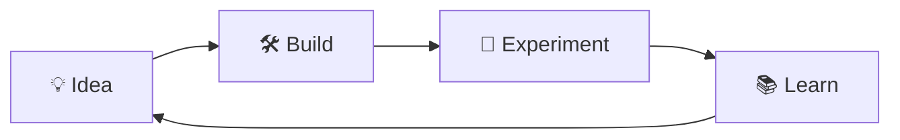

<!-- Replace YOUR-USERNAME and YOUR-REPO everywhere below -->

<div align="center">


<a href="https://github.com/GothicBath5/Web-Based">
  
</a>

<br/>


</div>

---

# About

A growing collection of **web-based projects, experiments, and creative explorations** built on the foundations of HTML, CSS, and JavaScript.

This repository is a space for **learning, building, and experimenting**. Rather than focusing on a single application, it brings together everything from small experiments to more developed interactive experiences, all of which run directly in your browser.
---

<details>
<summary><b>Project previews (click to expand)</b></summary>
<br/>

Add screenshots or GIFs of your projects here.

```markdown

```

</details>

</details>




---

## Project Status

This repository is **continuously evolving**. New projects, improvements, experiments, and learning materials may be added over time.

## Contributing!

Suggestions and ideas are welcome! Feel free to [open an issue](https://github.com/GothicBath5/Web-Based/issues) or fork the repo and try your own spin on an experiment.
